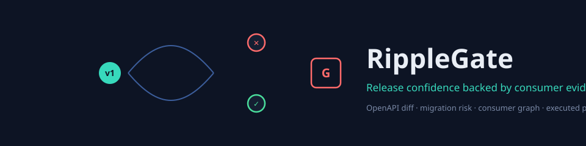
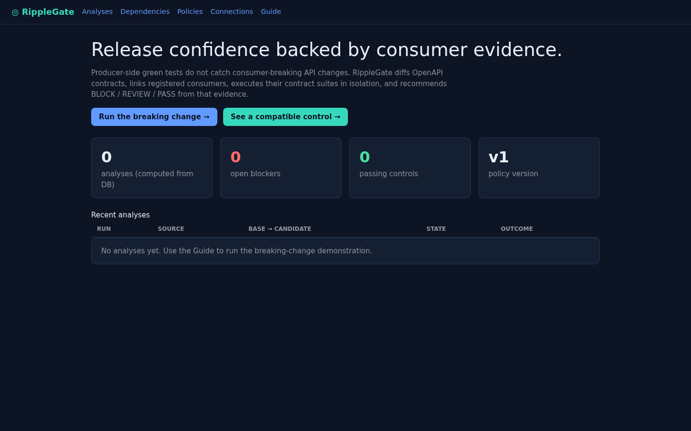

<p align="center"></p>

# RippleGate: release confidence backed by consumer evidence

RippleGate traces API changes to downstream consumers, reproduces compatibility failures, and gives release teams evidence they can act on. Producer-side green tests do not catch consumer-breaking changes; RippleGate connects the contract diff, the registered consumer graph, and executed contract tests into one auditable release decision.

[](https://github.com/etalyahsimpson/ripplegate/actions/workflows/ci.yml) · [Architecture](docs/ARCHITECTURE.md) · [Compatibility Rules](docs/COMPATIBILITY_RULES.md) · [Walkthrough](docs/REPRODUCE_BREAKAGE.md) · [Testing Evidence](docs/TESTING.md) · [Security](docs/SECURITY.md) · [Decision Log](docs/DECISIONS.md) · [Case Study](docs/CASE_STUDY.md) · [Data Provenance](docs/DATA_PROVENANCE.md)



*The dashboard above is a screenshot of the running application: analysis runs with their policy outcomes, loaded live from the API against the PostgreSQL store.*

## Three capabilities, one decision

1. **Change detection.** A bounded, deterministic OpenAPI 3.0/3.1 diff engine records every structural change at an exact JSON pointer, with a versioned rule set (`docs/COMPATIBILITY_RULES.md`) and directional request/response semantics.
2. **Downstream impact evidence.** The registered consumer dependency graph links each finding to the services that consume it, distinguishes affected from unaffected consumers, and keeps coverage honest: a finding with no registered consumer is UNKNOWN coverage, never "no consumers" (`docs/DATA_MODEL.md`).
3. **CI/PR release decisions.** Controlled consumer suites execute in isolation with real assertions, and the release policy emits `BLOCK`, `REVIEW`, `PASS` or `ERROR` with an evidence digest. GitHub Actions runs the full gate on every push and pull request; a breaking PR fails the gate by design.

## The 30-second walkthrough

The reference producer `orders-api` renames `customer_id` to `account_id` in `GET /orders/{id}`. RippleGate records `API-RESP-REQUIRED-REMOVED` (BREAKING, critical) at the exact schema pointer, links the registered billing-service edge, executes the billing contract suite, which fails with exit 1 on the missing field, and policy v1 returns **BLOCK** with the executed assertion as evidence. The compatible control adds an optional response field, passes both registered suites, and returns **PASS**. Reproduce both in under a minute: [docs/REPRODUCE_BREAKAGE.md](docs/REPRODUCE_BREAKAGE.md). Two controlled pull requests demonstrate the same gate live on GitHub: [PR #1](https://github.com/etalyahsimpson/ripplegate/pull/1) (breaking, gate correctly red) and [PR #2](https://github.com/etalyahsimpson/ripplegate/pull/2) (compatible, gate green).

## Architecture


PostgreSQL is the authoritative store for every run, finding and verdict; Redis is queue transport only. The rule engine lives in one deterministic module; the web app renders results and never re-classifies. The controlled runner executes pinned suites with a fixed argument vector and a hardened one-shot container profile. Full walkthrough: [docs/ARCHITECTURE.md](docs/ARCHITECTURE.md).

## Local run

Docker + Compose:

```
cp .env.example .env            # set the two signing secrets
docker compose up --build -d
bash scripts/bootstrap.sh && bash scripts/demo-breaking.sh && bash scripts/demo-compatible.sh
```

Without Docker (Python 3.12, Node 22, PostgreSQL 16): start `uvicorn` against your database, apply `db/migrations`, and run the same walkthrough scripts against `API_BASE_URL`. Health endpoints: `/api/v1/health` (liveness) and `/api/v1/ready` (readiness; 503 when PostgreSQL is down). Details: [docs/DEPLOYMENT.md](docs/DEPLOYMENT.md).

## Testing evidence

- **145 pytest tests** covering the parser bounds (size, depth, node budget, YAML anchors/aliases, external refs, cycles), rule directionality across OpenAPI 3.0/3.1 dialects, migration risk classification, policy calculus, authorization boundaries, webhook HMAC validation and dedup, database constraints, worker idempotency, and runner allowlist controls.
- **Expected-negative consumer checks**: the billing suite failing on the breaking candidate is asserted as correct detection in CI ([.github/workflows/ci.yml](.github/workflows/ci.yml)).
- **Web quality**: strict TypeScript typecheck and a production Next.js build.
- **Clean-clone verification**: the public repository clones fresh, installs locked dependencies, applies migrations, and reproduces the BLOCK and PASS scenarios end to end ([docs/RELEASE_RECOVERY.md](docs/RELEASE_RECOVERY.md)).

## Technology

Python 3.12 (FastAPI, Pydantic, Celery, psycopg, PyYAML safe loading), PostgreSQL 16 migrations, Redis 7 as queue, Next.js 15 App Router with TypeScript strict, Tailwind and TanStack Query, Node 22/Express reference consumer fixtures, Docker Compose, GitHub Actions. The closed technology lock is audited in CI by `scripts/verify-technology-lock.sh`; no other languages or frameworks are used.

## Tradeoffs and limits

Unsupported OpenAPI/SQL constructs stay UNKNOWN (fail closed) instead of guessed. Only registered consumers are mapped. Consumer execution covers the two pinned reference suites under a controlled fixture system. GitHub App Checks mode is `APP_MODE_UNCONFIGURED` without installation credentials. Public hosted deployment is not attempted in this environment; the Docker Compose path is the documented deployment route. Full detail: [docs/LIMITATIONS.md](docs/LIMITATIONS.md), [docs/DECISIONS.md](docs/DECISIONS.md), evidence map: [docs/EVIDENCE_INDEX.md](docs/EVIDENCE_INDEX.md), portfolio summary: [docs/PORTFOLIO_INTEGRATION.md](docs/PORTFOLIO_INTEGRATION.md).

## Data provenance

All example records are a versioned evaluation dataset prepared for testing: reference producer and consumer services, compatibility fixtures, and a preconfigured evaluation domain. See [docs/DATA_PROVENANCE.md](docs/DATA_PROVENANCE.md) for what each artifact is and how the schema structurally distinguishes fixture-sourced contracts from GitHub-sourced ones.

---

*Independent engineering portfolio project.* RippleGate was designed and built as a portfolio system: deterministic OpenAPI change analysis, supported PostgreSQL migration classification, registered consumer impact analysis, reproducible consumer tests, evidence-rich release decisions, authorization boundaries, and reviewable CI workflows. No customer, production traffic, or employer affiliation is claimed.
