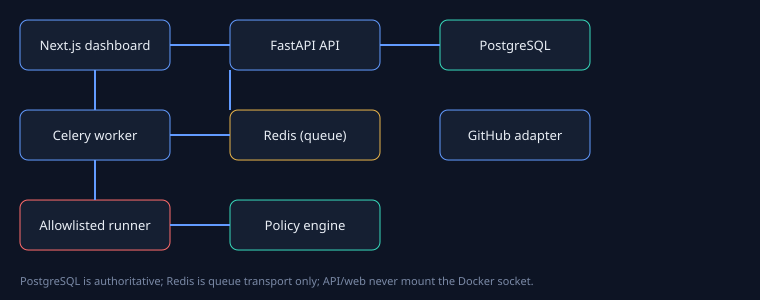

<p align="center"></p>

# RippleGate: Release confidence backed by consumer evidence.

Producer-side green tests do not catch consumer-breaking API and database changes. RippleGate knows which integrations a release will break, and shows the evidence before it ships.

**Status strip (all claims verified against the real repo):** CI [](https://github.com/etalyahsimpson/ripplegate/actions) · local runtime verified in the build sandbox against PostgreSQL 16 · public deployment `PUBLIC_DEPLOYMENT_NOT_VERIFIED` (no authorized host) · GitHub App mode `APP_MODE_UNCONFIGURED`.

Two immediate routes: **[Reproduce a breaking change](docs/REPRODUCE_BREAKAGE.md)** (`bash scripts/demo-breaking.sh` → BLOCK) and **[See a compatible control](docs/REPRODUCE_BREAKAGE.md)** (`bash scripts/demo-compatible.sh` → PASS).


*(Overview screenshot captured from the real running application against seeded runs; see docs/EVIDENCE_INDEX.md. If you are reading a fork before the screenshot was captured, this placeholder is intentionally absent rather than a mockup.)*

## Capabilities
OpenAPI 3.0/3.1 bounded diff · bounded PostgreSQL migration risk · registered consumer dependency graph · isolated executed consumer tests · deterministic policy (BLOCK/REVIEW/PASS) · GitHub Actions check path · human-governed release decisions.

## The four-layer evidence ladder (kept separate everywhere)
1. detected structural change (exact JSON pointer / SQL statement)
2. versioned rule classification (deterministic Python engine, never an LLM)
3. registered consumer impact (only declared edges; missing coverage stays UNKNOWN)
4. executed test outcome (real Node assertions, sanitized logs, digests)

`UNKNOWN`, `UNSUPPORTED`, runner outages and missing dependency information are first-class results and are **never** rendered as PASS.

## The 30-second story
`orders-api` renames `customer_id` → `account_id`. RippleGate records `API-RESP-REQUIRED-REMOVED` (BREAKING, critical) at `/paths/~1orders~1{id}/get/responses/200/.../properties/customer_id`, links the registered billing-service edge, executes its real contract suite (exit 1, `FAIL: response contains customer_id`), and policy v1 returns **BLOCK** with an evidence digest. The additive control (optional `fulfillment_note`) passes both suites and returns **PASS**. A human release owner retains final authority.

## Architecture


Full walkthrough: [docs/ARCHITECTURE.md](docs/ARCHITECTURE.md) · rules: [docs/COMPATIBILITY_RULES.md](docs/COMPATIBILITY_RULES.md) · data model: [docs/DATA_MODEL.md](docs/DATA_MODEL.md) · security: [docs/SECURITY.md](docs/SECURITY.md).

## Local run
Prereqs: Docker + Compose (or Python 3.12 / Node 22 / Postgres 16 / Redis 7). Then:

```
cp .env.example .env            # set the two signing secrets
docker compose up --build -d
bash scripts/bootstrap.sh && bash scripts/demo-breaking.sh && bash scripts/demo-compatible.sh
```

Health: `curl localhost:8000/api/v1/health` (liveness) and `/api/v1/ready` (readiness, 503 when Postgres is down).

## Tests
`python3 -m pytest tests/python -q` (145 tests incl. adversarial: forged sessions, tampered webhooks, oversized/cyclic contracts, cross-tenant denial, runner injection rejection, retry idempotency) · `node examples/billing-service/contract.test.js …breaking.json` (expected-negative exit 1) · `npm --prefix apps/web run typecheck && npm --prefix apps/web run build`. CI runs the same gates plus a real Postgres service ([.github/workflows/ci.yml](.github/workflows/ci.yml)).

## Technology
Python 3.12 (FastAPI/Pydantic/Celery/psycopg/PyYAML-safe), PostgreSQL 16 migrations, Redis 7 queue-only, Next.js 15 App Router + TypeScript strict + Tailwind + TanStack Query, Node 22/Express consumer fixtures, Docker Compose, GitHub Actions. Closed technology lock audited by `bash scripts/verify-technology-lock.sh`. No other languages/frameworks are used.

## Tradeoffs & limits
Unsupported OpenAPI/SQL constructs stay UNKNOWN (fail closed) instead of guessed. Only registered consumers are mapped. Consumer execution is limited to two pinned allowlisted suites - a controlled fixture system, not arbitrary-code sandboxing. Demo sessions are development identities. Details: [docs/LIMITATIONS.md](docs/LIMITATIONS.md), [docs/DECISIONS.md](docs/DECISIONS.md), evidence map: [docs/EVIDENCE_INDEX.md](docs/EVIDENCE_INDEX.md), portfolio: [docs/PORTFOLIO_INTEGRATION.md](docs/PORTFOLIO_INTEGRATION.md), case study: [docs/CASE_STUDY.md](docs/CASE_STUDY.md).

## Data ownership
All demo data is synthetic (`demo-platform`, fixture fingerprints, never fake git SHAs). No real customer data, no credentials in tracked files. License: none asserted; all content original.
