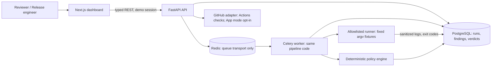

# Architecture

## Services and trust boundaries
- **API** `services/api/app/main.py` composes routes; all classification lives in `app/domain/` only.
  - `app/parsing/openapi_loader.py` bounded JSON/YAML loading (1 MiB, depth 32, 20k nodes, no anchors/aliases, local refs only).
  - `app/parsing/openapi_model.py` normalization to the supported subset; unsupported constructs raise with exact locations.
  - `app/parsing/sql_migration.py` bounded DDL tokenizer; never executes SQL.
  - `app/domain/rules.py` the single rule engine (versioned rule IDs, directional request/response semantics).
  - `app/domain/release_policy.py` BLOCK/REVIEW/PASS/ERROR calculus + run state machine (transactional transitions).
  - `app/infra/store.py` psycopg transactional store; Postgres authoritative. `UNIQUE(run_key)` arbitrates concurrent creates.
  - `app/auth/session.py` HMAC-signed demo sessions, expiry, membership re-check per request; roles never from headers.
  - `app/worker/pipeline.py` the QUEUED→…→COMPLETED pipeline; idempotent per stage (retried workers cannot duplicate findings/verdicts).
- **Worker** `services/worker/celery_app.py` runs the same `run_pipeline` over Redis; inline mode runs it in-process (local/CI default).
- **Runner** `services/runner/` fixed-argument-vector execution of the two pinned consumer suites; hardened Docker profile when a daemon exists; the API/web containers never mount the Docker socket.
- **Web** `apps/web/src` Next.js App Router; typed API client in `lib/api.ts`; all data from the API; SVG dependency graph with no third-party chart SDK.

## Why Postgres is authoritative
Redis is queue transport only. All run state, findings, test executions, assessments, webhook deliveries and audit live in Postgres with CHECK constraints and unique keys (see docs/DATA_MODEL.md). A lost Redis does not lose verdicts.

## Run lifecycle
`QUEUED → PARSING → DIFFED → IMPACT_MAPPED → TESTING → ASSESSED → COMPLETED`, plus `ERROR` (infrastructure) and `CANCELLED` (explicit). Transitions validated transactionally (`app/domain/release_policy.py:validate_transition`).
